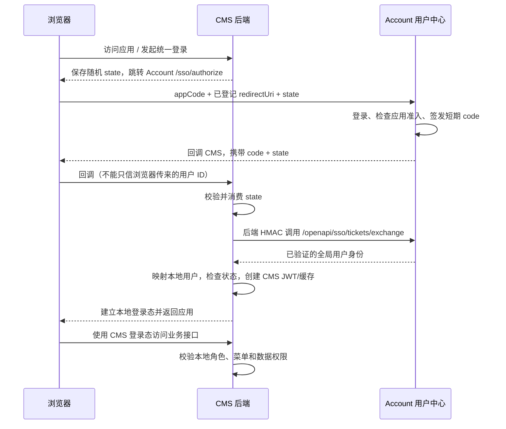

# 老应用接入：Starter、服务鉴权与统一登录

本说明基于 2026-09-17 Account 与 cms-ai 实际代码。菜单权限接入迁移已实施；下文 SSO 衔接是待实施设计，不能理解为 CMS 已完成统一登录。

## 一、应用要改什么

| 部分 | 应用侧工作 | 公共组件负责 |
| --- | --- | --- |
| 依赖 | 引入 `com.hypers:account-center-spring-boot2-starter:0.1.0-SNAPSHOT` | Java 8 协议 DTO、Controller、错误映射、HMAC Filter |
| 旧代码 | 移除复制的 `com.hypers.account.integration.menu`、旧 manifest、手工公共 Bean 注册；执行 clean 构建清除旧 class | 单一公共源码通过 Maven 分发 |
| 用户/菜单 | 实现 `AccountMenuPermissionHandler`，保留本地用户校验、菜单目录、权限版本和授权事务 | 标准查询/整集替换协议与边界校验 |
| 防重放 | 实现 `AccountNonceStore`，使用共享 Redis 的原子 SET NX + TTL | 签名、appCode、时间戳、Nonce 校验；存储失败拒绝请求 |
| 幂等/一致性 | 保存幂等结果和请求摘要、串行化同用户授权、处理 revision 冲突、权限变化后失效登录缓存 | 不替应用创建角色、表或事务 |
| 配置 | 显式启用、设置 appCode/Secret，保留业务锁和幂等 TTL | `account.integration.menu-permission` 公共属性 |
| 网络 | 设置 Account 到 Provider 的内网/受限 HTTPS 地址，部署侧限制来源，避免任意浏览器直接调用 | 不代替网关、防火墙或应用数据权限 |
| 统一登录 | 增加登录跳转、回调校验、code 兑换、可靠本地身份映射、签发本地登录态 | 当前 Boot 2 Starter 尚未提供 SSO 客户端 |

在 Account 工作区安装制品：

```powershell
.\scripts\Invoke-MavenJdk21.ps1 -f account/pom.xml -pl account-center-spring-boot2-starter -am install
```

业务应用 POM：

```xml
<dependency>
    <groupId>com.hypers</groupId>
    <artifactId>account-center-spring-boot2-starter</artifactId>
    <version>0.1.0-SNAPSHOT</version>
</dependency>
```

本机多个项目必须使用相同 Maven 仓库。团队电脑/CI 要安装相同制品或使用共享制品仓库；不能依赖开发机缓存才能构建。开发期 SNAPSHOT 更新后重新安装并重建消费者，正式交付使用固定发布版本。

## 二、CMS 本次适配

- `snowy-main-app/pom.xml` 增加 Starter；删除 17 个复制公共 Java 文件、`CmsAccountMenuPermissionConfiguration` 和旧 manifest。
- 保留 `CmsAccountMenuPermissionHandler`、`CmsMenuPermissionGrantService`、`RedisAccountNonceStore`、`CmsMenuPermissionRedisCoordinator`、`CmsLoginCacheEvictor` 及角色/用户角色优化。
- CMS 属性类只保留业务所需 appCode、幂等与锁 TTL；公共 enabled/Secret/时钟偏差由 Starter 绑定，避免在业务属性 `toString` 中泄漏 Secret。
- 配置前缀与原实现相同；原来的“提供 Secret 即默认启用”改为显式启用。`bootstrap.yml` 默认关闭，开发/部署环境需设置 `ACCOUNT_MENU_PERMISSION_ENABLED=true`、`ACCOUNT_MENU_PERMISSION_APP_CODE=cms-ai`、`ACCOUNT_MENU_PERMISSION_SECRET`。Secret 由环境/配置中心提供，两端一致，不提交仓库。
- 原网关和 Spring Security 的接入白名单保持不变。Starter 的 HMAC Filter 在 Spring Security 之前执行，只映射两个菜单 Provider 路径。不要再扫描公共包或手工注册公共 Controller/Filter。
- 初次切换必须 clean 构建，否则旧 target 中的复制 class 会覆盖 JAR，造成“代码删了但仍运行旧类”。IDE 也需重新导入 Maven 并清理旧输出。

核对环境中已生效的 Nacos 配置，不能仅凭仓库 YAML 判断线上开关或 Secret。现有账号、角色、授权关系和 Redis 命名空间不迁移、不清空。

## 三、接口是否裸露

必须区分三种请求身份：

| 请求 | 身份与保护 | 是否需要 CMS 用户 JWT |
| --- | --- | --- |
| 浏览器调用 CMS 普通业务接口 | CMS JWT、用户/角色/数据权限 | 是 |
| Account Server 调用 CMS 菜单 Provider | 应用 appCode + Secret 的 HMAC，时间窗、Nonce 防重放，Handler 业务校验 | 否，由服务身份鉴权 |
| 用户发起统一登录 | Account 登录会话、应用准入；回调 state + 一次性 code；CMS 后端签名兑换 | 登录成功前没有 CMS JWT |

当前 `/account-integration/v1/menu-permissions/query` 和 `/account-integration/v1/menu-permissions` 虽然在 CMS 用户登录白名单内，但有效端点有独立 HMAC Filter。请求签名覆盖方法、路径、时间戳、Nonce 和正文；不知道 Secret 的调用方不能只凭 URL 授权。Secret 只保存在两端后端，不能交给前端。

代码保护不等于部署网络隔离已完成。当前白名单前缀较宽，而 Filter 只保护上述两个精确路径；未来新增同前缀端点必须同步其鉴权，不能自动认为都受保护。正式部署优先使用内部 Provider 地址或限制来源的专用网关路由、TLS、审计与限流；本轮未修改既有网关配置或生产网络策略。

## 四、统一登录怎样串起来



Account 当前已有 `/sso/authorize`、已登记回调地址精确匹配、`/openapi/sso/tickets/exchange` 和 OpenAPI HMAC 过滤；这是一套自定义 ticket SSO，不能称为已实现 OIDC。

CMS 后续需要补齐：

1. 登录发起与回调入口。state 必须随机、短期、单次并绑定当前浏览器；CMS 是无状态 JWT 应用，可用短期 HttpOnly Cookie + 服务端 Redis 关联，不必因此改造所有业务 Session。
2. Boot 2 SSO 客户端：仅后端持有 Secret，签名兑换 code。服务端将验签 appCode 与兑换请求 appCode 绑定，回调只接受登记地址；错误/过期/重复 code 不得建登录态。
3. 全局 userId → CMS localUserId 的稳定映射。优先使用已确认的准入同步映射，不能只凭同名账号/邮箱自动绑定，也不能让前端指定 localUserId。用户不存在、禁用或未授权时拒绝；是否自动开户需另定业务规则。
4. 在已验证本地用户后复用 CMS `AuthServiceImpl.doLogin(SysUser)` 的 JWT、登录缓存和权限加载流程；验证状态/租户等原登录前置检查，不能简单绕开密码方法后遗漏这些检查。避免将长期 JWT 放在回调 URL；前后端分离可用短期单次登录结果码换本地 JWT，或按批准方案使用安全 Cookie。
5. 补齐注销与撤权语义：仅注销 CMS 还是全局注销、禁用后已有会话何时失效，需要明确实现并测试。菜单权限管理是独立后台流程，不能因为 SSO 成功就自动授予所有菜单。

## 五、SSO 上线前的已知缺口

- 当前 Account `SsoTicketService` 使用进程内 Map，`used` 的检查与赋值不原子；并发兑换可能重复成功，多实例也不能共享票据。正式 SSO 需改为原子单次消费与共享票据存储，单独验证并发、过期和实例切换。
- Account OpenAPI 的 NonceStore 目前也是内存实现；多实例部署需共享防重放存储。
- Boot 2 Starter 当前只有菜单权限 Provider；CMS 的用户同步、身份映射与 SSO 回调尚未由本次迁移补齐。

这些缺口来自实际代码，不属于本次依赖迁移的修改范围。SSO 联调应单独覆盖 state 篡改、错误回调、错误应用、禁用用户、撤权、code 重放/并发、跨租户和退出流程。

安全设计参考：[OWASP OAuth2 Cheat Sheet](https://cheatsheetseries.owasp.org/cheatsheets/OAuth2_Cheat_Sheet.html)。浏览器关联与 code 保护原则可用于审查当前方案；若转为标准 OIDC，采用成熟实现的授权码 + PKCE 流程，不能把自定义 ticket 接口直接称为 OIDC。
